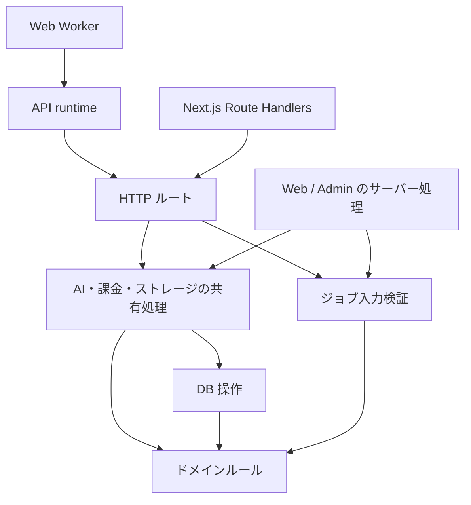

# 0003: HTTP ルートの組み立てと共有処理の入口を分ける

- 状態: Accepted
- 日付: 2026-10-20

## 背景

`@beutl/api` は Hono アプリの組み立てと、AI・課金・ストレージなどの共有処理を
同じ入口から公開していた。Admin がレスポンス読み取りヘルパーを使うだけでも、
静的な依存関係には v1/v2/v3 の全ルートが含まれていた。

さらに、Web の AI 再試行アクションが使う入力検証は `v3/ai/jobs.ts` にあった。
共有処理を公開するために HTTP ルートを参照する、責務と逆向きの依存になっていた。

## 決定

コードの責務に応じて `@beutl/api` の入口を分ける。

| 入口 | 責務 | 主な利用側 |
| --- | --- | --- |
| `@beutl/api/app` | `api`, `v1`, `v2`, `v3` の HTTP ルートを組み立てる | Next.js Route Handlers、HTTP 契約テスト |
| `@beutl/api/runtime` | Worker bindings、本文制限、DB の寿命、cron を管理する | Web Worker |
| `@beutl/api` | 既存利用側向けの互換バレル | 共有処理の契約テスト |
| `@beutl/api/ai/*` / `storage/*` など | 用途別の共有処理 | Web、Admin |
| `@beutl/api/response-body` | SDK に依存しないレスポンスのサイズ制限・UTF-8 検証 | Admin のログ・使用状況取得、Stripe 価格照会、OpenRouter adapter |
| `@beutl/api/ai/image-generation` | 画像生成の能力検証・利用量予約・実行・結果保存・失敗時の返金 | Web の生成・再試行アクション、画像生成 API |
| `@beutl/api/ai/translation` / `transcription` | 翻訳・文字起こしの予約・実行・JSON 保存・返金 | Web の字幕アクション、字幕 API |
| `@beutl/api/ai/image-editing` | 画像編集の能力検証・予約・実行・結果保存・返金 | Web の画像編集アクション、画像編集 API |
| `@beutl/api/ai/job-input` | 保存済みジョブ入力の検証と履歴用データの整形 | Web の再試行アクション、AI 履歴ルート |

依存方向は次のとおりとする。認証・エラー応答などの HTTP ヘルパーは引き続き
共有できるが、共有処理からルートの組み立てには依存しない。

- Web と Admin は用途別の公開サブパスを import する。ドメイン定数・型は
  `@beutl/core`、provider 共通の型・エラーは `ai/providers/types` / `errors` を参照する。
  汎用レスポンス読み取りは SDK・DB を参照しない。OpenRouter 側でエラーを変換し、
  通信断の実行結果不明と不正出力の確実な失敗という分類を維持する。
- 同一パッケージ内では実装モジュールを直接 import し、自分自身の公開バレルを
  経由しない。runtime の各 reconciler も対象とする。
- ルートと Server Action が共有する検証・業務処理は、ルートより下に置く。
  認証、HTTP/FormData の読み取り、応答形式への変換はそれぞれの入口に残す。
- 画像生成は `prepareImageGeneration` で能力検証と利用量予約を行い、新規予約だけが
  `execute` を持つ。HTTP 側は予約が確定してから SSE を開始し、共有処理は予約時に
  選んだモデルと入力で実行する。既存ジョブの取得と応答への変換は入口に残す。
  実行失敗は返金が完了した場合だけ失敗結果を返し、返金の DB 障害は呼び出し元へ送出する。
  翻訳・文字起こしも同じ予約と実行の境界を持つ。字幕のグループ情報は保存結果に残し、
  provider には時刻だけを渡す。文字起こしの結果回収と単語時刻の検証も共有する。
- 画像編集も共有サービスへ寄せ、入口ごとの JPEG 受け入れ条件と準備済み outpaint
  キャンバスの条件を維持する。動画は `video-jobs.ts` が provider への登録・紐付け、
  登録失敗時の返金／待機継続、および状態同期を担当する。HTTP 側は callback の認証と
  応答を担当し、callback・poll・cron は同じ状態同期を使う。
- Web の Stripe 処理は `lib/stripe` に置く。顧客作成とメール同期は `customer.ts`、
  退会時の決済精算と顧客削除は `customer-closure.ts` が担当し、所有権の検証を共有する。
  Webhook の署名検証と HTTP 応答は route、検証済みイベントの処理は `webhook.ts` が担当する。
  Subscription Checkout は遷移先 URL を返し、Server Action が redirect を行う。
  既存の DB トランザクション、および返金・キャンセルと外部呼び出しの順序を維持する。
- 保存済み入力、課金単位、冪等性キー、外部向け URL・応答の互換性を維持する。
- `@beutl/core` はフレームワーク非依存、`@beutl/db` は永続化を担当する。
  `@beutl/api` の共有処理は DB や外部サービスを利用できるため、純粋関数の層とは異なる。
- `core` と `db` の内部モジュールは循環させない。単純な照会が、アカウント削除のような
  複数領域にまたがる操作を import しないよう、`user-lookup.ts` に存在確認を分離する。
  公開する `@beutl/db` の関数と、呼び出し元のトランザクションを使う契約は維持する。

Web と公開 API を同じ Worker で配信する決定、および NuGet・画像処理 Worker の
用途は [ADR 0002](0002-api-worker-split.md) に従う。
v1 の認証契約は [ADR 0001](0001-v1-account-is-the-auth-backbone.md) に従う。

## 検証

`cloudflare-memory-footprint.test.ts` は Hono のルーターモジュールを読み込めない
条件で実際に共有入口を import する。共有処理からルートへの依存が復活すると失敗する。
`routing-parity.test.ts` と Web 入口の契約テストは、HTTP 側の同じルート登録と応答を検証する。
ジョブ入力の移動は既存の AI 履歴・ダッシュボードテストで検証する。
画像生成は既存の API・SSE・ダッシュボードテストに加え、Web と API をまたぐ再送を
実際の予約・保存・返金処理で検証する。モデルを無効化しても結果を回収できること、
二重生成・二重課金・二重返金を避けること、返金障害を完了扱いにしないことを確認する。

`module-dependencies.test.ts` は TypeScript の依存解決を使い、`core` / `db` 内の循環、
上位の workspace、Next.js・React・Hono への依存を検出する。型だけの参照も対象とし、
`db` から他の workspace への依存は `core` に限定する。
Stripe サービスも循環、Next.js の直接参照、アプリケーションルートへの逆向き参照を検出する。
顧客・退会・Checkout・Webhook の契約テストで決済処理と HTTP 応答・画面遷移を検証する。
Web / Admin の root import の再導入と、未公開サブパスの利用も境界テストで検出する。
レスポンス読み取りは SDK・DB を読み込めない条件で Admin の利用側を import し、
ストリーム中のバイト数制限・中断・UTF-8 と provider 側のエラー変換を検証する。
PR の CI では workspace の型チェック、Web / Admin の OpenNext ビルド、および一時的な
CockroachDB を使った既存の整合性・マイグレーションテストも実行する。
