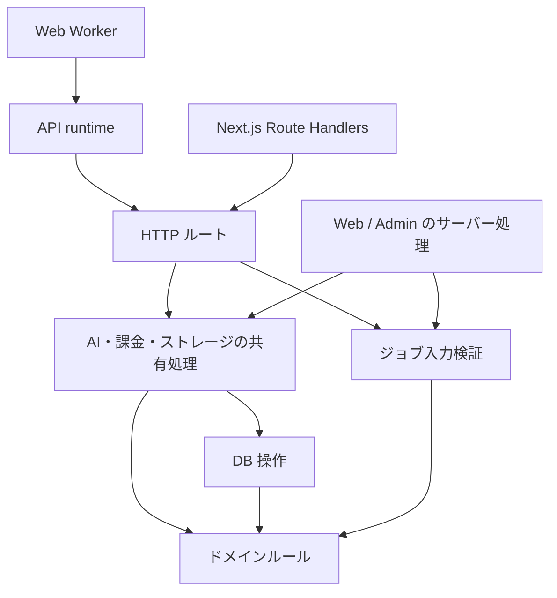

# 0003: HTTP ルートの組み立てと共有処理の入口を分ける

- 状態: Accepted
- 日付: 2026-10-20

## 背景

`@beutl/api` は Hono アプリの組み立てと、AI・課金・ストレージなどの共有処理を
同じ入口から公開していた。Admin がレスポンス読み取りヘルパーを使うだけでも、
静的な依存関係には v1/v2/v3 の全ルートが含まれていた。

さらに、Web の AI 再試行アクションが使う入力検証は `v3/ai/jobs.ts` にあった。
共有処理を公開するために HTTP ルートを参照する、責務と逆向きの依存になっていた。

## 決定

コードの責務に応じて `@beutl/api` の入口を分ける。

| 入口 | 責務 | 主な利用側 |
| --- | --- | --- |
| `@beutl/api/app` | `api`, `v1`, `v2`, `v3` の HTTP ルートを組み立てる | Next.js Route Handlers、HTTP 契約テスト |
| `@beutl/api/runtime` | Worker bindings、本文制限、DB の寿命、cron を管理する | Web Worker |
| `@beutl/api` | ルートを組み立てない共有処理を公開する | Web、Admin、業務処理のテスト |
| `@beutl/api/ai/job-input` | 保存済みジョブ入力の検証と履歴用データの整形 | Web の再試行アクション、AI 履歴ルート |

依存方向は次のとおりとする。認証・エラー応答などの HTTP ヘルパーは引き続き
共有できるが、共有処理からルートの組み立てには依存しない。

- 同一パッケージ内では実装モジュールを直接 import し、自分自身の公開バレルを
  経由しない。runtime の各 reconciler も対象とする。
- ルートと Server Action が共有する検証・業務処理は、ルートより下に置く。
  認証、HTTP/FormData の読み取り、応答形式への変換はそれぞれの入口に残す。
- 保存済み入力、課金単位、冪等性キー、外部向け URL・応答の互換性を維持する。
- `@beutl/core` はフレームワーク非依存、`@beutl/db` は永続化を担当する。
  `@beutl/api` の共有処理は DB や外部サービスを利用できるため、純粋関数の層とは異なる。

Web と公開 API を同じ Worker で配信する決定、および NuGet・画像処理 Worker の
用途は [ADR 0002](0002-api-worker-split.md) に従う。
v1 の認証契約は [ADR 0001](0001-v1-account-is-the-auth-backbone.md) に従う。

## 検証

`cloudflare-memory-footprint.test.ts` は Hono のルーターモジュールを読み込めない
条件で実際に共有入口を import する。共有処理からルートへの依存が復活すると失敗する。
`routing-parity.test.ts` と Web 入口の契約テストは、HTTP 側の同じルート登録と応答を検証する。
ジョブ入力の移動は既存の AI 履歴・ダッシュボードテストで検証する。

## 次の改善候補

入口の分離後も、業務処理の配置には改善余地がある。次は変更する機能ごとに
既存の契約テストを使って移行する。

1. `dashboard/ai/actions.ts` と `v3/ai/` が持つ予約・実行・結果保存の処理を、
   操作単位の共有サービスへ寄せる。二重実行防止、返金、再試行を同じ単位で扱う。
2. `apps/web/src/lib/customer.ts` と Stripe 関連処理の責務を、顧客管理・checkout・
   webhook の用途で整理する。DB トランザクションと外部呼び出しの境界を保持する。
3. Web と Admin の共有処理利用を、必要なサブパスへ順次移す。
   汎用レスポンス読み取りの OpenRouter SDK 依存なども、この単位で解消する。
